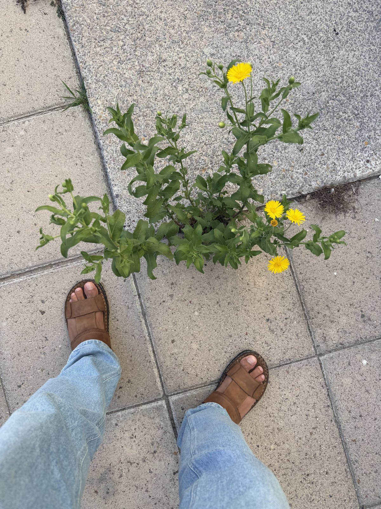
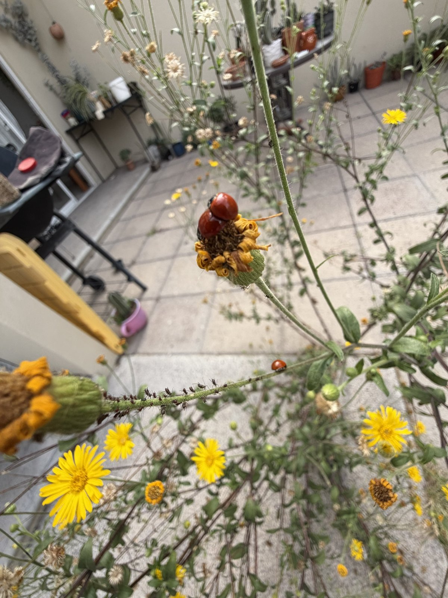

# MENTEMONEDA — La planta de flores amarillas

*Sesión: 25 de noviembre de 2026*

> **Qué es este archivo:** el registro de una experiencia vivida, contada por Jaibo. Sus palabras van tal como las escribió, con la ortografía corregida y sin cambiar nada más. Lo que no es suyo está marcado como observación de Claude.

---

## La experiencia

> «En una ocasión, mirando una planta en un día soleado por la tarde, disfrutando el convivir con mis amigos, charlando, fui a orinar a un lugar; ahí estaba la planta. Yo me encontraba al aire libre, en el rancho, en una parcela. La planta tenía flores amarillas pequeñas y bastas. Había todo un ecosistema ahí: abejas rondando y demás insectos y plantas. Sentí que me observó y yo la observé. En ese momento sentí que nos conocimos y de alguna manera nuestra existencia se validó. Dudo que alguien más la observara como yo, hablando de esa misma planta. Puede ser que en otra variante sintiente pudiere ser.»

## La planta del patio

> «Ahora, en el patio de mi casa, creció una planta similar en medio de los ladrillos. No hay pasto; nació en una pequeña hendidura de los ladrillos que cubren el piso. Inclusive mis perros se la comieron dos veces cuando era pequeña, yo la arranqué un par de veces, y ahora creció demasiado y me recuerda tanto a esa planta. Tiene muchas flores amarillas.»

## Las semillas

> «Está creciendo, y no solo eso: he recolectado las semillas para llevarlas a mi pueblo y esparcirlas.»

> «Es como la decisión que tomé en algún punto, es bastante parecida. Para ser honesto, no sé el género. Varios días pasados, mientras recolecto las semillas, he pensado en que esos momentos lleguen a pasar. Me he imaginado todas las posibilidades y no las cubro, pero sé que tienen que observar.»

## El ecosistema del patio

**Observación de Claude, a partir de la foto:** la planta ya sostiene su propio ecosistema. Hay pulgones a lo largo de un tallo, una catarina caminando hacia ellos y dos catarinas sobre una cabezuela seca, que parecen estar apareándose. Se ven también cabezuelas secas con pelusa blanca (vilano), de donde salen las semillas.

**Identificación, observación de Claude, no confirmada:** familia de las margaritas (Asteráceas). Por las hojas que abrazan el tallo, los tallos con pelitos y el vilano, probablemente del género *Heterotheca*. En el centro de México lo más común sería la árnica mexicana (*Heterotheca inuloides*) o *Heterotheca subaxillaris*. Si es así, es nativa de México.

### El nombre

Lo trajo Jaibo, de la [ficha de *Heterotheca inuloides* en Wikipedia](https://es.wikipedia.org/wiki/Heterotheca_inuloides):

- ***Heterotheca*:** del griego *heterós*, «diferente», y *théke*, «receptáculo»: «receptáculo diferente», por los frutos desiguales de las especies del género.
- ***inuloides*:** «parecida a *Inula*».
- **Nombres comunes:** acahual (de origen náhuatl, para asteráceas amarillas), árnica de campo, árnica de monte, árnica mexicana, cuauteteco, falsa árnica, hornilla, tabaco de las montañas, xochihuepal.

**Observación de Claude:** los «frutos desiguales» son dos clases de semilla en la misma cabezuela. Las de las florecitas del centro llevan vilano, la pelusa que las deja viajar con el viento; las de los pétalos de la orilla suelen no llevarlo, o llevarlo muy reducido, y caen cerca. Una misma flor suelta semillas para llegar lejos y semillas para quedarse.

### Lo que se sabe de ella

Fuente que trajo Jaibo: Rodríguez-Chávez, J. L., Egas, V., Linares, E., Bye, R., Hernández, T., Espinosa-García, F. J., y Delgado, G. (2017). «Mexican Arnica (*Heterotheca inuloides* Cass. Asteraceae: Astereae): Ethnomedical uses, chemical constituents and biological properties». *Journal of Ethnopharmacology*, 195, 39–63. DOI: [10.1016/j.jep.2016.11.021](https://doi.org/10.1016/j.jep.2016.11.021). [PubMed 27847336](https://pubmed.ncbi.nlm.nih.gov/27847336/).

Es una revisión de la literatura. Según su resumen:

- **Usos tradicionales en México:** reumatismo, inflamación de la piel, dolor muscular y cólicos, dolor ligado a inflamación, enfermedades dentales y trastornos gastrointestinales.
- **Química:** más de 140 compuestos identificados; los autores consideran que los sesquiterpenos de tipo cadinano son los principales componentes activos.
- **Actividad:** la antiinflamatoria y la citotóxica tienen respaldo en estudios farmacológicos.
- **Límites que señalan los propios autores:** los reportes sobre su toxicidad son limitados, y el modo de acción de sus componentes necesita más investigación.

---

## Conexiones con la obra

Registradas como posibles, no como decididas:

- **La suculenta y el colibrí** ([mentemoneda_suculenta_colibri.md](mentemoneda_suculenta_colibri.md)): otra planta y otro encuentro irrepetible.
- **El reconocimiento mutuo:** «sentí que me observó y yo la observé»; la relación ocurre antes que cada uno por separado.
- **La irreproducibilidad de cada mirada:** «dudo que alguien más la observara como yo».
- **La decisión como semilla:** se suelta sin poder cubrir todas las posibilidades; el encuentro depende de que otros observen.
- **Receptáculo diferente:** el nombre de la planta dice lo que Jaibo dijo de las decisiones: algunas llegan muy lejos y otras se quedan en el camino.

---

*Jaibo Rojas — MENTEMONEDA*
